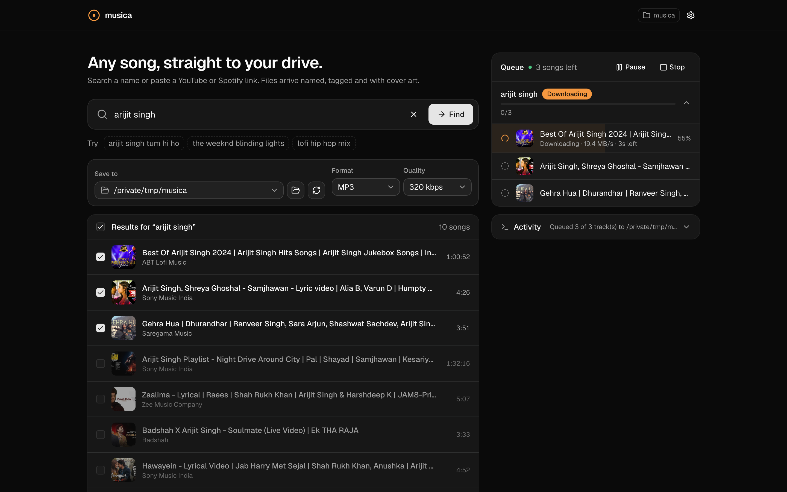

# Musica

Musica is basically just think of a simple way to download music

you can paste link of spotify or yt and it will download the music for you 
this was previously local project that i had made but i continued it 

# Motivation 

i wanted to download music to put in pen drive and just got annoyed by ads of the fishy website so i thought of making my own which is clean and good.

it was pretty awesome solving an issue of my own 

## it is free to use , you can spin it up in your own server and use it or download in your local machine

# Process 

basically the code of the api is what i got in github from people who had already made similar things. i just slapped a api on top of it using python and made frontend and asked ai to help me host this thing 

# Ai usage note 

i had previously made ui but it was sloppy so i asked ai to help me make better ui , ai also helped me to debug my backend when i got problem .  many issues came seeing code from github and making similar like that

also ai helped me to host ,but the app flow and api are made by me

## A note on use

This is a personal tool. Only download music you have the right to download and keep in mind that downloading from YouTube may go against its terms of service where you live.
