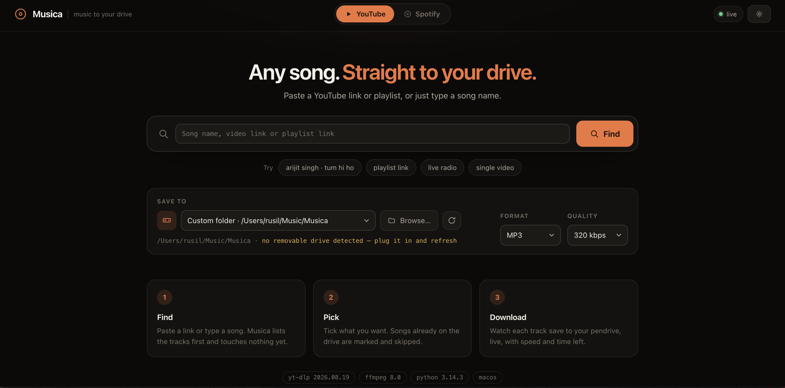
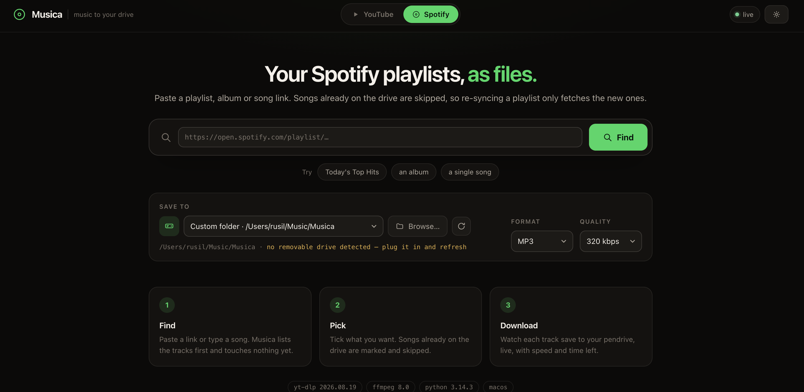

# Musica

Musica is a small music downloader that runs on your own computer and puts MP3s straight onto a USB pendrive. You paste a YouTube link, a playlist, a Spotify link, or just type a song name, check what it found, and press download. The files come out named properly, tagged, and with cover art, so they look right in a car stereo and not just on a laptop.



I built it because getting music onto a stick for the car was always more annoying than it should be. Online converters are full of ads, the file names come out as `Tum Hi Ho (Official Video) [4K] - T-Series.mp3`, half the head units can't read the tags, and copying the same playlist again a month later means sorting through duplicates by hand. Musica handles all of that in one place.

It runs locally. There is no account, no database, and nothing is sent anywhere except the requests to YouTube and Spotify needed to find and download the songs.

## What it does

- **Search or paste.** Type a song name, or paste a YouTube video, a YouTube playlist, or a Spotify track, album or playlist link. You get a preview list first and can untick anything you don't want before downloading.
- **Finds your pendrive.** Removable drives are detected on macOS, Linux and Windows. You can also pick any folder instead.
- **Skips what you already have.** It keeps a small archive file on the drive itself, so syncing the same playlist again only downloads the new songs, even from a different computer. It also compares file names loosely, so a different upload of a song you already have gets flagged too.
- **Car-friendly files.** With car mode on (the default), tags are written as ID3v2.3 with an ID3v1 tail, cover art is kept small enough for head units to show, a `folder.jpg` is dropped next to the files, and playlist tracks get a `01 - ` prefix so they play in order on stereos that sort by file name.
- **Clean names.** Titles are stripped of things like "(Official Video)" and "Full Song", and names are kept short enough (counted in bytes, not characters) to be safe on FAT32 even with Hindi or other non-Latin titles.
- **Spotify playlists.** Spotify doesn't serve audio, so Musica reads the track list from Spotify and then finds the best matching upload on YouTube for each song. You get Spotify's clean titles, artists, album name and cover.
- **Safe writes to the drive.** Each song is downloaded and converted on your internal disk first, then copied to the pendrive as one finished file. The slow part happens on the fast disk, and the drive only ever sees complete songs.
- **Queue with progress.** Live progress, pause, cancel and retry for failed songs, all in the browser.
- **Format a drive.** If your stick is NTFS and the car can't see it, you can reformat it to FAT32 or exFAT from the app. It asks you to type `FORMAT` first.
- **Update yt-dlp from the UI.** YouTube changes often, and when downloads start failing the fix is usually a newer yt-dlp. There is a button for that.

Output formats are MP3 (128 to 320 kbps), M4A, Opus, OGG, FLAC and WAV. MP3 is the default since it plays everywhere.

The Spotify side works the same way. Paste a playlist, album or song link and you get the same preview, destination picker and queue:



## Requirements

- Python 3.10 or newer
- [ffmpeg](https://ffmpeg.org/) on your PATH, for converting audio
- A JavaScript runtime (Node, Deno or Bun) on your PATH. Recent yt-dlp needs one for some YouTube lookups. Without it things may still work, but YouTube can refuse requests.

On macOS:

```bash
brew install ffmpeg node
```

On Ubuntu or Debian:

```bash
sudo apt install ffmpeg nodejs
```

## Getting started

Clone the repo and run the launcher:

```bash
git clone https://github.com/rusilkoirala/musica.git
cd musica
./musica.sh
```

The first run creates a virtual environment in `.venv` and installs the dependencies (using [uv](https://github.com/astral-sh/uv) if you have it, plain pip otherwise). After that it starts the server and opens `http://127.0.0.1:8000` in your browser.

If you'd rather set it up yourself:

```bash
uv sync                 # or: python3 -m venv .venv && .venv/bin/pip install fastapi "uvicorn[standard]" yt-dlp psutil mutagen requests
.venv/bin/python -m app
```

Options:

```
python -m app --port 9000        # use a different port
python -m app --host 0.0.0.0     # listen on your network (be careful, there is no login)
python -m app --no-browser       # don't open a browser tab
```

### Spotify support

Spotify links are read through [spotDL](https://github.com/spotDL/spotify-downloader), which is not installed by default. Its own dependency pins clash with the versions of FastAPI and uvicorn this app uses, so install it without its pinned dependencies and add the libraries it actually needs:

```bash
uv pip install --python .venv/bin/python --no-deps spotdl
uv pip install --python .venv/bin/python spotipy rapidfuzz python-slugify pykakasi \
    beautifulsoup4 syncedlyrics ytmusicapi soundcloud-v2 platformdirs rich
```

Then open `http://127.0.0.1:8000/spotify`, or just paste a Spotify link into the normal search box. Playlists have to be public.

## Settings

Settings are saved to `~/.config/musica/settings.json`. You can change this location with the `MUSICA_CONFIG_DIR` environment variable. Everything is editable from the settings panel in the app; the main ones are:

| Setting | Default | What it does |
| --- | --- | --- |
| Format / quality | MP3, 320 kbps | Output codec and bitrate |
| Naming | Artist - Title | Or just the title |
| Playlist subfolders | off | Put each playlist in its own folder |
| Skip near-duplicates | on | Skip songs whose name closely matches a file already on the drive |
| Archive on drive | on | Keep the download history on the pendrive instead of on this computer |
| Stage locally | on | Download to the internal disk first, then copy to the drive |
| Car mode | on | ID3v2.3 tags, ID3v1 tail, small cover art, `folder.jpg` |
| Number files | on | `01 - ` prefix on playlist tracks |
| Cookies file | empty | A `cookies.txt` exported from your browser, for videos that need sign-in |

## Project layout

```
app/
  __main__.py   entry point: starts uvicorn and opens the browser
  main.py       FastAPI routes the page talks to
  ytdl.py       everything that touches yt-dlp: search, download, tagging, staging
  spotify.py    turns Spotify links into track lists
  library.py    download archive and duplicate detection
  drives.py     removable drive detection and formatting
  sanitize.py   file name cleanup and fuzzy name matching
  queue.py      download queue, progress and server-sent events
  config.py     settings file
static/         the web page (plain HTML, CSS and JavaScript, no build step)
tests/          check scripts
musica.sh       launcher
```

## Tests

The `tests/` folder holds plain check scripts rather than a pytest suite. Run them from the project root:

```bash
.venv/bin/python -m tests.check_naming      # name cleanup and fuzzy matching
.venv/bin/python -m tests.check_frontend    # the page's JS and HTML agree on element ids
.venv/bin/python -m tests.check_library     # duplicate rules against real files (needs ffmpeg)
.venv/bin/python -m tests.check_download    # one real download from YouTube, end to end
.venv/bin/python -m tests.check_car         # tags and artwork a car stereo can read
.venv/bin/python -m tests.check_longname    # very long, non-Latin names (needs the server on port 8137)
```

`check_car` and `check_longname` reuse the file that `check_download` saves, so run that one first. Anything the scripts write goes to `tests/.work/`, which is ignored by git.

## A note on use

This is a personal tool. Only download music you have the right to download, and keep in mind that downloading from YouTube may go against its terms of service where you live.
